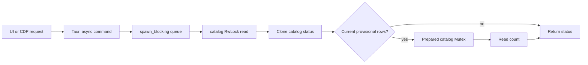

# Filename status latency: source audit and proposal

Baseline: `c6fffe4` (2026-11-16). This is a code-reading proposal; no product
locking or status behavior has changed. The relevant index/command/pipeline/UI
sources match those in the measured `5054b8c` CI app.

`index_status` can wait for **two catalog locks**, despite already running off
the Tauri main thread. Separating published status from entry storage is a
reasonable next change. The existing measurements do not yet establish which
lock, worker scheduling or IPC/rendering stage caused the observed long polls.

## Measured boundary

The actual release comparison used profiling off, fresh owned portable
profiles, software rendering and a one-CPU/512-MiB app/WebView Job:

| Case | App         | Status calls | Total status-call ms | Maximum status-call ms | First complete to idle-ready ms |
| ---- | ----------- | ------------ | -------------------- | ---------------------- | ------------------------------- |
| A1   | e4 baseline | 52           | 3,457                | 1,984                  | 51                              |
| B1   | Hash reuse  | 61           | 3,411                | 2,133                  | 2,290                           |
| B2   | Hash reuse  | 49           | 2,958                | 1,549                  | 40                              |
| A2   | e4 baseline | 58           | 3,865                | 2,449                  | 2,598                           |

B1/A2 reported `initialScanComplete: true` while `scanning: true`; their row
counts then changed by 9/100 before idle-ready. The last status polls were long.
Those observations do not prove that watch pruning held a writer for the same
duration. The 5-7 second cached whole-list target remains open.

The complete-to-ready interval also includes the harness's first-complete Job
report. A1/B2 already reported complete and not scanning in that status response,
so their 51/40-ms gaps do not indicate additional scan work. B1/A2 required
another poll, including the report and a 100-ms retry pause. Their 2.290/2.598-s
gaps are observation intervals, not measured writer holds.

The timer surrounds `await invoke('index_status')` in
[harsh-profile.mjs](../../tests/native/harsh-profile.mjs#L194).
[The harness invoke](../../tests/native/harness.mjs#L223) uses page evaluation
and Tauri IPC. Its total therefore includes renderer/CDP scheduling, IPC,
blocking-pool admission, backend lock waits and response work. The harness adds
a sequential probe after a 100-ms pause between checks; the actual
[UI poll](../../src/lib/use-search.ts#L75) schedules its next request 400 ms
after a scanning response, or 1,000 ms while idle. The probe is extra load on
top of the app. The host was 69-75% busy; the historical service was outside the
Job, on NVMe, with its cache retained. This is a real responsiveness concern
and a hypothesis to isolate, not an attributed writer-hold measurement.

## Current lock path

- [commands.rs:323](../../src-tauri/src/commands.rs#L323) already uses
  `spawn_blocking`. This prevents synchronous catalog waiting on the Tauri main
  thread, but the caller's promise can still wait. Cloning `state.index` here
  does not acquire the settings mutex.
- [FileIndex::status](../../src-tauri/src/index.rs#L680) takes
  `catalog.read()` and calls `status_of` with that guard still held.
- [status_of](../../src-tauri/src/index.rs#L688) clones `IndexStatus`. When the
  real catalog is empty and the current generation has provisional rows,
  [provisional](../../src-tauri/src/index.rs#L734) also takes the prepared
  entries' `Mutex` to obtain the count. Status can therefore hold a catalog
  read lock while waiting on this second lock.
- [Preparation workers](../../src-tauri/src/filename_pipeline.rs#L80) hold the
  prepared mutex across insertion of a batch of up to 2,048 rows. Unicode
  preparation is outside that mutex, but compact insertion is inside it.
- [Search](../../src-tauri/src/index.rs#L1386) holds the catalog read guard and,
  during provisional search, the prepared mutex across matching/ranking. Thus
  provisional status can directly wait behind a search as well as an insertion
  worker. Ordinary live-catalog searches hold read locks, which do not by
  themselves exclude another reader. Do not assume a particular platform's
  reader/writer queue fairness to explain a long status call.

The inspected paths use catalog-to-prepared lock order. Preparation workers do
not acquire the catalog lock while holding their insertion guard. This audit
does not identify a lock-order deadlock; it identifies blocking/hold boundaries.
The low-priority indexing workers can also be descheduled while holding a lock;
long wall hold time need not imply the same amount of CPU work.

## Writer boundaries that need attribution

| Path                                                                      | Work while the catalog write guard is held                                                                                                                                      |
| ------------------------------------------------------------------------- | ------------------------------------------------------------------------------------------------------------------------------------------------------------------------------- |
| [Refresh/configure](../../src-tauri/src/index.rs#L632)                    | Detach provisional rows; clear or retain entries after scope/policy changes; reset status/revision. Retain/clear/reclamation depends on catalog size.                           |
| [Scan finish](../../src-tauri/src/index.rs#L1132)                         | Whole-catalog `retain_seen_or` for reconciliation, or subtree enumeration/stale-key collection/removal for watch updates; then count/revision/complete/scanning changes.        |
| [Walk publication](../../src-tauri/src/index.rs#L1339)                    | Apply prepared replacement/seen updates, update count/revision/skipped/scanning. Normal walker batches are 512 rows; text/table maintenance may occur during insertion/removal. |
| [Provisional publication](../../src-tauri/src/filename_service.rs#L339)   | Take the joined prepared map under its mutex, detach provisional state, shrink storage, swap the real catalog and set status. The no-gap swap is important.                     |
| [Other initial publication](../../src-tauri/src/filename_catalog.rs#L227) | Shrink and swap an empty catalog; otherwise leave the lock and use checked batches.                                                                                             |
| [Provisional refresh](../../src-tauri/src/filename_service.rs#L317)       | `try_write` avoids waiting for the catalog, but after success it still waits for the prepared mutex while holding the writer. This refresh is throttled to about once a second. |

Warnings/watcher state, service fallback, skipped counts, successful service
timing/counters, overflow counts, provisional display and failure-detach also
mutate status under catalog writers. A cache implementation must audit these
producers, not only the initial-scan success path.

## Recommended design

Use a **coherent, separately published status snapshot**, rather than independent
atomics for each numeric field. A small standard-library status store can hold
an immutable `Arc<IndexStatus>` (plus internal generation/attempt metadata)
behind a short mutex. The getter clones the Arc under that mutex, releases it,
then builds/serializes the DTO outside the lock. It never reads entry storage,
waits for the prepared catalog or scans paths. Avoid new dependencies and avoid
an unbounded seqlock/spin retry on a one-CPU machine.

The publication contract should be explicit:

1. Publish a coherent last-committed status at every canonical status mutation
   boundary. Keep `revision` semantics and diagnostics-only fields, including
   successful snapshot timing and reset counters. Centralize the commit helper
   or guard so early returns do not silently miss publication. The status lock
   must never be held while acquiring a data lock, doing I/O or waiting on workers.
2. During provisional insertion, publish a lightweight count after each batch
   using its existing known length, after releasing the prepared mutex. Tag it
   with generation **and a distinct preparation-attempt token**. The same
   generation can have another attempt. Late callbacks must not resurrect a
   failed/detached attempt or overwrite a newer generation.
3. Counts can use monotonic-max merging only within one active provisional
   attempt: workers may publish completed batches out of order. Live removals,
   reset/failure and a transition to validated rows must still decrease or
   replace counts correctly. A metadata publication must not overwrite newer
   provisional progress. It must not call `status_of` to rediscover the count,
   because that would reacquire the heavy prepared mutex.
4. Switch provisional-to-live source/token, count and status coherently at the
   existing validated publication point; invalidate the attempt on failure,
   cancellation, owner loss and refresh. Respect a concurrent valid writer that
   fills the live catalog. Do not retain a prepared catalog, row arena or
   `FileIndex` lifetime owner in the status cache.
5. Independent `count/scanning/initialScanComplete/revision` loads are not a
   coherent snapshot, even with sequentially consistent atomics. Preserve
   `initialScanComplete` during watch work and reset it for the next configured
   generation. Specify visibility during a pending refresh, and ensure new
   settings/refresh completion cannot be followed by stale cached status or
   warnings from an older generation. Preserve the existing poisoned-catalog
   error behavior instead of hiding it behind an old successful snapshot.

Keep the authoritative catalog status in search responses and
[snapshot_files](../../src-tauri/src/index.rs#L1484). That path checks the exact
revision and reports partial snapshots under the real catalog lock. A lightweight
progress snapshot must not become authorization, source freshness or snapshot
validation evidence. The UI currently ignores count-only status changes until
revision/scanning/completion changes; preserve the existing revision cadence and
two-second requery throttle instead of triggering a new whole-catalog query
after every incoming batch.

There is another boundary outside this change:
[refresh_index](../../src-tauri/src/commands.rs#L353) holds the settings mutex
while requesting a catalog refresh. A fast status getter does not remove that
wait or make all commands independent of catalog work. Do not move its settings
read earlier and reintroduce an old-settings refresh race as part of this work.

## Small diagnostic step before implementation

The source supports the design, but first split the measured total without
changing behavior:

- Record async-command entry to blocking-worker entry (pool wait).
- Around `FileIndex::status`, distinguish catalog read acquisition, provisional
  mutex acquisition and status cloning/count work.
- At writer boundaries above, distinguish acquisition wait from actual hold
  time, using fixed region labels such as refresh, scan-reconcile, watch-prune,
  walk-publish and validated-swap. Record timing after releasing data locks.
- Use bounded numeric counts/totals/maxima in requested diagnostics, with no
  filenames, paths or queries. Keep this outside the existing eight-phase CPU
  schema. Reuse the dedicated developer/test opt-in discipline; with it off,
  there must be no clocks, per-batch environment reads or new recorder locks.
  Time status calls and batches, never each row.

Then compare the largest backend waits with the end-to-end calls in the same
window. Fast backend work with long end-to-end calls points toward renderer/IPC
or scheduling; a large catalog/prepared acquisition wait identifies a different
next step. Aggregate maxima alone do not identify an individual blocking writer;
bounded numeric interval evidence can be added if needed. Do not promote an
observed maximum to a guaranteed latency upper bound.

## Acceptance and regression plan

- In a synthetic controlled test, keep a catalog writer blocked on an owned
  release gate and confirm status returns before that writer is released.
  Repeat while the provisional mutex is held. Gate/order assertions are the
  correctness check; avoid a fragile sub-millisecond CI timing assertion.
- Cover coherent generation/revision/flags, sticky initial completion during
  watch work, provisional progress, out-of-order batches, failure-detach and
  replacement by a concurrent live writer. Test stale callbacks after refresh,
  a second attempt in one generation, owner loss and poisoned storage.
- Preserve all filename/search/snapshot/policy regressions and strict Clippy,
  and verify Windows/macOS/Linux compilation. Normal IPC JSON and disabled
  native-launch environment remain unchanged.
- With the approved implementation, compare the same actual CI apps and owned
  profiles under one CPU/512 MiB, recording backend wait and end-to-end status
  separately. A lower status-call latency is its own outcome; it does not
  establish faster service transfer, full startup or the 5-7 second target.

Existing numeric evidence and source hashes are retained privately under
`C:/Users/solso/prism-agent-work-20261115/status-lock-analysis.json`, referencing
`native-hash-reuse-qualification.json` and the original four-case raw result.
This audit ran no new GUI, Rust build or benchmark. No lock/cache implementation
has been applied.
