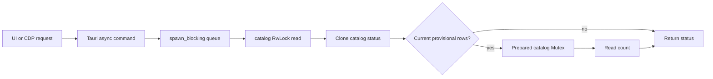

# Filename status latency: source audit and proposal

Audit baseline: `c6fffe4` (2026-11-16). The source audit and controlled local
experiment below describe that baseline, whose relevant index/command/pipeline/UI
sources match the measured `5054b8c` CI app. The later developer-only timing
hooks and lightweight published-status implementation are described separately
below. Search and RAG continue to use canonical storage; the status getter now
uses a separate progress snapshot.

At that baseline, `index_status` can wait for **two catalog locks**, despite
already running off the Tauri main thread. The new implementation removes
those dependencies from the getter. The existing measurements do not yet
establish which lock, worker scheduling or IPC/rendering stage caused the
observed long polls, or quantify the new implementation's actual GUI latency.

## Measured boundary

The actual release comparison used profiling off, fresh owned portable
profiles, software rendering and a one-CPU/512-MiB app/WebView Job:

| Case | App         | Status calls | Total status-call ms | Maximum status-call ms | First complete to idle-ready ms |
| ---- | ----------- | ------------ | -------------------- | ---------------------- | ------------------------------- |
| A1   | e4 baseline | 52           | 3,457                | 1,984                  | 51                              |
| B1   | Hash reuse  | 61           | 3,411                | 2,133                  | 2,290                           |
| B2   | Hash reuse  | 49           | 2,958                | 1,549                  | 40                              |
| A2   | e4 baseline | 58           | 3,865                | 2,449                  | 2,598                           |

B1/A2 reported `initialScanComplete: true` while `scanning: true`; their row
counts then changed by 9/100 before idle-ready. The last status polls were long.
Those observations do not prove that watch pruning held a writer for the same
duration. The 5-7 second cached whole-list target remains open.

The complete-to-ready interval also includes the harness's first-complete Job
report. A1/B2 already reported complete and not scanning in that status response,
so their 51/40-ms gaps do not indicate additional scan work. B1/A2 required
another poll, including the report and a 100-ms retry pause. Their 2.290/2.598-s
gaps are observation intervals, not measured writer holds.

The timer surrounds `await invoke('index_status')` in
[harsh-profile.mjs](../../tests/native/harsh-profile.mjs#L194).
[The harness invoke](../../tests/native/harness.mjs#L223) uses page evaluation
and Tauri IPC. Its total therefore includes renderer/CDP scheduling, IPC,
blocking-pool admission, backend lock waits and response work. The harness adds
a sequential probe after a 100-ms pause between checks; the actual
[UI poll](../../src/lib/use-search.ts#L75) schedules its next request 400 ms
after a scanning response, or 1,000 ms while idle. The probe is extra load on
top of the app. The host was 69-75% busy; the historical service was outside the
Job, on NVMe, with its cache retained. This is a real responsiveness concern
and a hypothesis to isolate, not an attributed writer-hold measurement.

## Current lock path

- [commands.rs:323](../../src-tauri/src/commands.rs#L323) already uses
  `spawn_blocking`. This prevents synchronous catalog waiting on the Tauri main
  thread, but the caller's promise can still wait. Cloning `state.index` here
  does not acquire the settings mutex.
- [FileIndex::status](../../src-tauri/src/index.rs#L680) takes
  `catalog.read()` and calls `status_of` with that guard still held.
- [status_of](../../src-tauri/src/index.rs#L688) clones `IndexStatus`. When the
  real catalog is empty and the current generation has provisional rows,
  [provisional](../../src-tauri/src/index.rs#L734) also takes the prepared
  entries' `Mutex` to obtain the count. Status can therefore hold a catalog
  read lock while waiting on this second lock.
- [Preparation workers](../../src-tauri/src/filename_pipeline.rs#L80) hold the
  prepared mutex across insertion of a batch of up to 2,048 rows. Unicode
  preparation is outside that mutex, but compact insertion is inside it.
- [Search](../../src-tauri/src/index.rs#L1386) holds the catalog read guard and,
  during provisional search, the prepared mutex across matching/ranking. Thus
  provisional status can directly wait behind a search as well as an insertion
  worker. Ordinary live-catalog searches hold read locks, which do not by
  themselves exclude another reader. Do not assume a particular platform's
  reader/writer queue fairness to explain a long status call.

The inspected paths use catalog-to-prepared lock order. Preparation workers do
not acquire the catalog lock while holding their insertion guard. This audit
does not identify a lock-order deadlock; it identifies blocking/hold boundaries.
The low-priority indexing workers can also be descheduled while holding a lock;
long wall hold time need not imply the same amount of CPU work.

## Writer boundaries that need attribution

| Path                                                                      | Work while the catalog write guard is held                                                                                                                                      |
| ------------------------------------------------------------------------- | ------------------------------------------------------------------------------------------------------------------------------------------------------------------------------- |
| [Refresh/configure](../../src-tauri/src/index.rs#L632)                    | Detach provisional rows; clear or retain entries after scope/policy changes; reset status/revision. Retain/clear/reclamation depends on catalog size.                           |
| [Scan finish](../../src-tauri/src/index.rs#L1132)                         | Whole-catalog `retain_seen_or` for reconciliation, or subtree enumeration/stale-key collection/removal for watch updates; then count/revision/complete/scanning changes.        |
| [Walk publication](../../src-tauri/src/index.rs#L1339)                    | Apply prepared replacement/seen updates, update count/revision/skipped/scanning. Normal walker batches are 512 rows; text/table maintenance may occur during insertion/removal. |
| [Provisional publication](../../src-tauri/src/filename_service.rs#L339)   | Take the joined prepared map under its mutex, detach provisional state, shrink storage, swap the real catalog and set status. The no-gap swap is important.                     |
| [Other initial publication](../../src-tauri/src/filename_catalog.rs#L227) | Shrink and swap an empty catalog; otherwise leave the lock and use checked batches.                                                                                             |
| [Provisional refresh](../../src-tauri/src/filename_service.rs#L317)       | `try_write` avoids waiting for the catalog, but after success it still waits for the prepared mutex while holding the writer. This refresh is throttled to about once a second. |

Warnings/watcher state, service fallback, skipped counts, successful service
timing/counters, overflow counts, provisional display and failure-detach also
mutate status under catalog writers. A cache implementation must audit these
producers, not only the initial-scan success path.

## Recommended design

Use a **coherent, separately published status snapshot**, rather than independent
atomics for each numeric field. A small standard-library status store can hold
an immutable `Arc<IndexStatus>` (plus internal generation/attempt metadata)
behind a short mutex. The getter clones the Arc under that mutex, releases it,
then builds/serializes the DTO outside the lock. It never reads entry storage,
waits for the prepared catalog or scans paths. Avoid new dependencies and avoid
an unbounded seqlock/spin retry on a one-CPU machine.

The publication contract should be explicit:

1. Publish a coherent last-committed status at every canonical status mutation
   boundary. Keep `revision` semantics and diagnostics-only fields, including
   successful snapshot timing and reset counters. Centralize the commit helper
   or guard so early returns do not silently miss publication. The status lock
   must never be held while acquiring a data lock, doing I/O or waiting on workers.
2. During provisional insertion, publish a lightweight count after each batch
   using its existing known length, after releasing the prepared mutex. Tag it
   with generation **and a distinct preparation-attempt token**. The same
   generation can have another attempt. Late callbacks must not resurrect a
   failed/detached attempt or overwrite a newer generation.
3. Counts can use monotonic-max merging only within one active provisional
   attempt: workers may publish completed batches out of order. Live removals,
   reset/failure and a transition to validated rows must still decrease or
   replace counts correctly. A metadata publication must not overwrite newer
   provisional progress. It must not call `status_of` to rediscover the count,
   because that would reacquire the heavy prepared mutex.
4. Switch provisional-to-live source/token, count and status coherently at the
   existing validated publication point; invalidate the attempt on failure,
   cancellation, owner loss and refresh. Respect a concurrent valid writer that
   fills the live catalog. Do not retain a prepared catalog, row arena or
   `FileIndex` lifetime owner in the status cache.
5. Independent `count/scanning/initialScanComplete/revision` loads are not a
   coherent snapshot, even with sequentially consistent atomics. Preserve
   `initialScanComplete` during watch work and reset it for the next configured
   generation. Specify visibility during a pending refresh, and ensure new
   settings/refresh completion cannot be followed by stale cached status or
   warnings from an older generation. Preserve the existing poisoned-catalog
   error behavior instead of hiding it behind an old successful snapshot.

Keep the authoritative catalog status in search responses and
[snapshot_files](../../src-tauri/src/index.rs#L1484). That path checks the exact
revision and reports partial snapshots under the real catalog lock. A lightweight
progress snapshot must not become authorization, source freshness or snapshot
validation evidence. The UI currently ignores count-only status changes until
revision/scanning/completion changes; preserve the existing revision cadence and
two-second requery throttle instead of triggering a new whole-catalog query
after every incoming batch.

There is another boundary outside this change:
[refresh_index](../../src-tauri/src/commands.rs#L353) holds the settings mutex
while requesting a catalog refresh. A fast status getter does not remove that
wait or make all commands independent of catalog work. Do not move its settings
read earlier and reintroduce an old-settings refresh race as part of this work.

## Small diagnostic step before implementation

The source supports the design, but first split the measured total without
changing behavior:

- Record async-command entry to blocking-worker entry (pool wait).
- Around `FileIndex::status`, distinguish catalog read acquisition, provisional
  mutex acquisition and status cloning/count work.
- At writer boundaries above, distinguish acquisition wait from actual hold
  time, using fixed region labels such as refresh, scan-reconcile, watch-prune,
  walk-publish and validated-swap. Record timing after releasing data locks.
- Use bounded numeric counts/totals/maxima in requested diagnostics, with no
  filenames, paths or queries. Keep this outside the existing eight-phase CPU
  schema. Reuse the dedicated developer/test opt-in discipline; with it off,
  there must be no clocks, per-batch environment reads or new recorder locks.
  Time status calls and batches, never each row.

Then compare the largest backend waits with the end-to-end calls in the same
window. Fast backend work with long end-to-end calls points toward renderer/IPC
or scheduling; a large catalog/prepared acquisition wait identifies a different
next step. Aggregate maxima alone do not identify an individual blocking writer;
bounded numeric interval evidence can be added if needed. Do not promote an
observed maximum to a guaranteed latency upper bound.

## Controlled local lock experiment

The local compiler is Rust 1.99.0, commit
`b940084d7eb6a299eb4bfeb8e34901bc051e7ac4`, target
`x86_64-pc-windows-msvc`. Its
[backend selection](https://raw.githubusercontent.com/rust-lang/rust/b940084d7eb6a299eb4bfeb8e34901bc051e7ac4/library/std/src/sys/sync/rwlock/mod.rs)
selects the futex RwLock for this Windows target, rather than SRW. The Windows
[futex operations](https://raw.githubusercontent.com/rust-lang/rust/b940084d7eb6a299eb4bfeb8e34901bc051e7ac4/library/std/src/sys/sync/futex/windows.rs)
use WaitOnAddress/WakeByAddress. The
[reader admission check](https://raw.githubusercontent.com/rust-lang/rust/b940084d7eb6a299eb4bfeb8e34901bc051e7ac4/library/std/src/sys/sync/rwlock/futex.rs)
rejects a new reader when waiting flags are set. These are implementation facts
about this pinned local toolchain, not a portable queue-order promise or a
verification of the exact standard library in the earlier CI app.

A private source copy added thread-local wall timers around the production
status path's catalog and prepared lock acquisitions. No shared recorder lock
was added inside those regions. The normal lock order and status logic were
retained. Synthetic FileIndex state was constructed directly without starting
its background worker. There was no Tauri, GUI, service, filesystem enumeration
or real user input. A fresh process Job enforced one CPU and 512 MiB before the
start gate. Writer/holder threads called the production background-priority
helper; effective thread priorities were not separately read back.

Four conditions ran three times each, with deliberately configured 200-ms
holds. A compatible reader-only condition provided a control. The queued-writer
condition kept an initial reader held, started a writer, and waited until a new
`try_read` returned WouldBlock before starting status. No writer could own the
lock at that checkpoint, so the failed new read identifies queued-writer
admission blocking. Release/response gates and recorded status revisions then
observed the ordering after the initial reader was released.

| Condition                           | Status total wall ms (range, 3 runs) | Dominant measured acquisition wall ms         | Observation                                                                                                       |
| ----------------------------------- | ------------------------------------ | --------------------------------------------- | ----------------------------------------------------------------------------------------------------------------- |
| Existing reader only                | 0.0004-0.0096                        | Catalog: at most 0.0001                       | Status returned while that reader remained held.                                                                  |
| Existing reader plus waiting writer | 202.4-207.3                          | Catalog: 202.4-207.3                          | Status remained pending during the initial reader's 200-ms hold after a writer queued.                            |
| Writer already holding catalog      | 200.1-203.5                          | Catalog: 200.1-203.5                          | Status returned after the held writer released.                                                                   |
| Prepared mutex already held         | 202.0-232.4                          | Prepared: 202.0-232.4; catalog at most 0.0001 | Status held a catalog read guard while blocked on the second mutex; its result saw the synthetic provisional row. |

All 12 scenarios passed. The waiting writer therefore **can delay a fresh
status reader even while an existing reader would otherwise be compatible**.
The second prepared-mutex dependency is independently observable.

Post-release ordering needs a qualification: in all three queued-writer runs, status read
the old revision and completed before the writer committed. That writer still
subsequently held the lock for its own configured 200 ms. Status did not wait
for that additional hold. The first fixture incorrectly required writer commit
before the waiting status returned; its ordering assertion failed and that
attempt was retained. The revised fixture preserves the queued-writer
precondition but records the acquisition/commit outcome instead of prescribing it.
Do not assume a strictly additive reader-hold-plus-writer-hold wait.

These numbers measure acquisition wall windows, including scheduling during
the calls. The critical sections intentionally wait on release gates: they do
not measure the natural duration of a real search, publish, scan or watch job.
The original GUI's 1.5-2.4-second delay is still unattributed. The experiment
supports decoupling status from both locks; the earlier backend/IPC diagnostic
split remains necessary to attribute that specific production observation.

The successful run took 2.922 seconds, minimum available host RAM was
4,965,675,008 bytes, and no resource guard fired. Inputs/executable hashes were
unchanged. All case threads joined, and Job close plus handle waits confirmed
no owned process remained. Strict all-target Clippy and the release build
passed for the private fixture. No product cache or timing hooks were applied.

Private evidence is in
`C:/Users/solso/prism-agent-work-20261115/status-lock-probe-controlled-v2/`,
`status-lock-probe-source/`, `status-lock-probe-candidate-v2/`,
`status-lock-primary-sources/` and `status-lock-controlled-qualification.json`
in the same parent. The unsuccessful first run, its binary and its frozen
inputs remain in `status-lock-probe-controlled/`, `status-lock-probe-candidate/`
and `status-lock-probe-v1-failed-inputs/`. Primary-source hashes and the compiler
version are retained alongside the successful results.

## Developer-only timing hooks

The follow-up adds `filenameIndex.filenameStatusProfile` to diagnostics only
when both existing cached flags, `PRISM_DEV_FILENAME_CPU_PROFILE=1` and
`PRISM_DEV_FILENAME_CPU_TEST_MODE=1`, enable the Windows collector. There is no
new environment variable or normal status/search DTO field. The CPU profile's
eight phases and schema version 2 remain unchanged; status wall windows have a
separate schema version 1. With profiling disabled, the new hooks call no
clocks and take no recorder mutex. This does not claim zero branch/plumbing cost.

The eight read regions are `poolWait`, `catalogWait`, `catalogHold`,
`preparedWait`, `preparedHold`, `dtoBuild`, `workerTotal` and `commandTotal`.
`poolWait` begins immediately before `spawn_blocking` and ends at getter entry,
so it includes dispatch/scheduling overhead. Direct Rust getter calls have no
pool or command-total sample. DTO work covers status cloning and provisional
count assignment, excluding serialization. Worker total ends after both data
guards are released, before recorder acquisition; command total adds the pool
window. Neither measures outbound Tauri/renderer work or recorder contention.

Catalog writers are labeled refresh, metadata, scan start, reconcile, watch
prune, walk publish, provisional show/refresh/swap/drop, initial publish and
first batch. Prepared insertion has one timing span per existing batch, not
per row. Writer summaries distinguish acquisition wait from hold, preserve
poisoned recovery and report failed `try_write` attempts without hold samples.
Hold endpoints are sampled immediately before unlocking, avoiding inflation
if a woken reader preempts the background writer at unlock. Counters are
recorded after the measured data guard is dropped. The snapshot copies fixed
counters under its own mutex, then releases it before allocation/serialization.

All acquisition/hold values are wall windows and include scheduling. Regions
overlap: prepared waiting occurs inside catalog holding, and DTO count work
occurs inside prepared holding. Totals and maxima must not be summed.
`slowestWorker` and `slowestCommand` each retain one coherent completed getter
record; maxima from separate summary rows may describe different calls.
There are no paths, filenames, queries or row values in this profile.
These summaries cannot identify an exact concurrent writer or attribute the
older GUI's 1.5-2.4-second polls without new actual-app measurements.

Local filename QA passed with profiling off and on: **125 tests passed and
7 opt-in tests ignored in each process**; strict all-target Clippy passed.
Eight new tests cover disabled clock calls, overlapping/coherent records,
WouldBlock, poison recovery, unchanged normal DTO/privacy and data-lock release
before recording. An actual getter regression deliberately holds the recorder
and observes both catalog/prepared locks becoming available before the getter
can finish recording. No background worker, GUI or service is needed for these
synthetic checks. The off/on guarded runs took 33.375/27.828 seconds including
Cargo overhead; these are verification durations, not performance comparisons.
No resource stop fired and all owned processes exited after Job close/waits.

The native harsh harness requires this status schema and queued calls only in
its existing explicit profiling-on mode. The shared launch environment and
profiling-off output are unchanged. At this local qualification, full app,
cross-platform CI and actual release wiring were pending; the later native
baseline below adds separate evidence. Local lean QA alone does not validate
those paths. Private logs and input hashes are in
`C:/Users/solso/prism-agent-work-20261115/filename-status-timing-{off,on,clippy}-v4/`
and `filename-status-timing-qualification.json` in the same parent. Earlier
fixture borrow-check/lint failures are retained separately and are not counted
as successful runs.

## Actual release baseline with timing hooks

CI `43755090886` built the timing-only `b7e46d7` source. Artifact
`14177698569` was admitted from this repository's `main` dispatch of
`.github/workflows/release.yml`; its ZIP SHA-256 is
`c42f72ec9efc1008bd57188167bc8774a758acef6ac19a31db8d63b66e98d008`.
The 379,890,688-byte executable has SHA-256
`ad9bf7606abd0eb0c8bd5bd805bb864cc299abc15d72101dc0b0539c6821485c`.
The local source already contained the snapshot follow-up, but the executed
binary was this pinned timing-only CI app; its harness/environment files were
byte-identical to `b7e46d7`. Baseline production sources are frozen separately.

Four fresh owned portable profiles ran software rendering and a kernel-read-back
one-CPU/512-MiB app/WebView Job, in off/on/on/off order:

| Case | Timing | First searchable ms | Idle-ready ms | End-to-end poll maximum ms | Slowest backend command ms | Catalog wait in that backend call ms |
| ---- | ------ | ------------------- | ------------- | -------------------------- | -------------------------- | ------------------------------------ |
| 1    | Off    | 6,877               | 16,622        | 2,903                      | Not recorded               | Not recorded                         |
| 2    | On     | 2,923               | 12,216        | 2,363                      | 2,352.997                  | 2,352.963                            |
| 3    | On     | 2,799               | 13,657        | 2,987                      | 2,958.627                  | 2,958.594                            |
| 4    | Off    | 2,929               | 11,363        | 1,859                      | Not recorded               | Not recorded                         |

All four passed. Off emitted neither CPU nor status profiles; on emitted the
expected schemas with zero lost measurements. The two coherent slowest backend
records were dominated by **catalog acquisition**, with pool windows only
0.0325/0.0324 ms and catalog hold 0.0005/0.0006 ms in those same calls. This
directly observes second-scale backend lock acquisition in a real release app.
Prepared-mutex acquisition maxima in other calls were 370.473/507.877 ms.
Its nested hold/wait windows must not be added to catalog hold or command totals.

Watch-prune writer hold maxima were 1,951.343/2,176.188 ms; prepared-insert hold
maxima were 65.665/60.314 ms. The numeric aggregates have no common call/holder
IDs or absolute span timeline, so they do not establish which writer or search
blocked a particular getter. Likewise, the end-to-end maxima and backend maxima
are not paired by ID: do not subtract their values to claim measured IPC cost.
Profiles include UI, harness and direct diagnostic getters completed before
the post-ready diagnostic snapshot. These are new calls, not identification of
the original historical four-case calls.

The run took 70.125 seconds; minimum available RAM was 4,856,197,120 bytes.
No resource guard fired, executable/harness/service hashes stayed unchanged
and no owned process remained after Job close. Mean host CPU busy per case
ranged from 69.5% to 71.9%. Live counts increased from 2,146,732 to 2,147,463;
service validated-fetch times ranged from 7,599 to 12,971 ms. These variations
prevent treating the on/off ready times as causal profiling overhead or a
startup improvement. This establishes timing activation and a baseline for
the snapshot product change, whose GUI effect is still unmeasured.

The historical installed service stayed PID 5924 / SHA `d0b1fe5e...`, outside
the app Job. Its exact image was not present in this candidate. There was no
upgrade, UAC, user-profile access, service-cache reset or physical HDD test.
At observation, macOS checks/universal build and Linux x64 CI had passed;
Windows later gates and Linux ARM64 Flatpak were still running. This baseline
does not claim overall release-CI success or the 5-7 second startup target.

Private evidence is retained outside worktrees in
`C:/Users/solso/prism-agent-work-20261115/harsh-status-baseline-b7-abba/`,
`candidate-b7e46d7/`, `status-baseline-b7-inputs/` and
`native-status-baseline-b7-qualification.json` in the same parent. Numeric
proofs, raw logs and owned local screenshots remain private; none was uploaded.

## Lightweight published status

`FileIndex::status` now clones a coherent progress snapshot from a separate
short `Mutex`, without acquiring catalog or prepared storage. The mutex guards
an immutable `Arc<IndexStatus>` and its optional provisional generation/attempt
token. The getter captures that Arc and the attempt's count together, releases
the mutex, then clones the DTO outside it. It still checks the catalog's atomic
poison flag and returns the existing error for poisoned storage. No settings
mutex or worker join is involved. The normal IPC JSON is unchanged.

The existing central `write_catalog`/`try_write_catalog` guards commit status
before releasing their canonical writer, including early returns. Arc creation
and previous-snapshot destruction occur outside the status mutex. A canonical
generation tag rejects a writer revoked during its work or snapshot creation.
Panic unwinding does not publish partially modified state. A poll during a
long writer returns the preceding committed status, rather than waiting for
the in-progress mutation. This is a progress projection, never authority for
search filtering, opening a result or RAG revision validation.

Each preparation owns a separate small `Arc<Progress>` containing only its
atomic row count. Workers update that count after releasing their insertion
guard; `fetch_max` tolerates batches completing their callbacks out of order.
The published snapshot references that token only while its exact attempt is
the current provisional source and the real catalog remains empty. A token
does not own the prepared map or rows. Late updates to an old attempt cannot
affect a replacement attempt, even in the same generation. Metadata commits
retain the token instead of replacing its newer count with an older DTO count.

Generation/owner revocation hides provisional progress immediately on the
getter's next snapshot read, even if its canonical detach is still waiting
behind a search. Failed/detached attempts, validated swaps and concurrent live
writers stop overlaying that token. Live counts can decrease; monotonic merging
is confined to one unfinished preparation. Refresh, completion, watcher state,
warnings, revision and diagnostic service timing still come from the canonical
writer commits. Existing search/RAG paths keep their original data locks and
revision/permission checks.

The existing DEV wall profile adds `snapshotWait` and `snapshotHold` read rows
and optional fields in its coherent slowest-call records. Legacy catalog and
prepared read columns remain for comparison; the new getter never samples
those entry locks (`entryStorageLockUsed: false`). Its catalog numeric columns
are zero and prepared columns absent; those zeros are not acquisition samples
from a real catalog read. Snapshot hold ends before unlock and DTO cloning
occurs afterward. CPU schema 2, the two-flag gate and disabled clock behavior
are unchanged. No measured wall windows should be added together.

Seven new snapshot regressions check completion while both data locks remain
held, generation/owner revocation, stale same-generation attempts, out-of-order
counts, coherent revision/flags, arena release, count decreases and an actual
concurrent first-batch writer followed by validated provisional merging. The
earlier status-lock test is updated to the separate-snapshot contract. Existing
scan, service-failure/cancellation, policy, search and snapshot tests remain.
Final local off/on filename QA each passed **132 tests with 7 opt-in tests
ignored**; strict all-target Clippy and the 21 Node compatibility tests passed.
The guarded off/on runs took 33.109/28.328 seconds including Cargo overhead,
with minimum available host RAM 5,851,738,112/5,972,967,424 bytes. No resource
stop fired and all owned processes exited after Job close/waits. These run
durations are test verification, not an on/off performance experiment.
The input hashes, logs and two initial fixture compilation failures are recorded in
`C:/Users/solso/prism-agent-work-20261115/filename-status-snapshot-qualification.json`.
At local qualification, full app/nonWindows CI and actual-app comparison were
pending; the next section records the subsequent CI/native evidence.
This implementation does not establish a maximum latency guarantee, attribute
the historical 2-second polls, or accept the 5-7 second startup target.

## Actual published-status comparison

CI `43756415303@599762a` passed all platform jobs. Its Windows artifact
`14178709482` has ZIP SHA-256
`fada2753e7ecd6c840ff11930519e45eda0c35e9c9352531b88108b41e586e84`;
the 379,692,032-byte executable has SHA-256
`083c6a7b190b55a50741f465a57c721adb2faf889082f7fcb2647e4f6e8e8f14`.
The same admitted release workflow, harness, software renderer, one-CPU/512-MiB
kernel limits, historical service and fresh owned portable profiles were used
in off/on/on/off order. All four cases passed.

| Timing-on case | Probe maximum ms, before → after | Probe mean ms, before → after | Process-wide backend command mean ms, before → after |
| -------------- | -------------------------------- | ----------------------------- | ---------------------------------------------------- |
| First          | 2,363 → 59                       | 69.907 → 9.338                | 96.526 → 1.375                                       |
| Second         | 2,987 → 31                       | 81.051 → 8.745                | 94.480 → 2.436                                       |

The probe populations were 54/59 calls before and 65/55 after. The backend
profile includes other UI and diagnostic calls, so its means are a separate
population, not an IPC component subtracted from probe means. Before and after
runs were sequential rather than interleaved.

New coherent slowest backend commands were 115.743/161.816 ms, almost entirely
pool windows of 115.738/161.811 ms. Their worker windows were 0.0047/0.0046 ms,
with snapshot-mutex wait 0.0004/0.0002 ms. Catalog acquisition/hold were zero
and prepared acquisition/hold absent: the release app exposed the intended
new snapshot path. These records do not identify all UI scheduling costs or
guarantee a maximum latency for future calls. One profiling-off probe still
took 437 ms; the other off case's maximum was 32 ms.

Off ready times were 9,843/9,670 ms versus the earlier 16,622/11,363 ms. Those
are observations, not an isolated startup gain. New mean host CPU busy ranged
from 60.2% to 68.5%, versus baseline 69.5-71.9%, and service validated-fetch
times ranged from 6,127 to 7,862 ms. Live counts also changed to about 2.15
million. The 5-7 second cached whole-list target remains unaccepted.

The new four-case run took 56.453 seconds, minimum available RAM was
4,842,065,920 bytes, no resource stop fired and no owned process remained.
Executable/harness/service hashes were unchanged, and the service remained
PID 5924 / SHA `d0b1fe5e...` outside the app Job. No user Prism profile/process,
UAC, service upgrade, cache reset or physical HDD was involved.

Private proof is
`C:/Users/solso/prism-agent-work-20261115/native-status-snapshot-qualification.json`,
with raw runs in `harsh-status-snapshot-599-abba/`, candidate provenance in
`candidate-599762a/` and frozen production/harness inputs in
`status-snapshot-native-inputs/` under the same parent. No local raw evidence
was uploaded. The next investigation is watch-prune writer cost, independent
of the now-separated status getter.

## Regression coverage and remaining native acceptance

- The synthetic getter test confirms completion before either held data lock
  is released. Its timeout bounds failure; there is no fragile sub-millisecond
  latency assertion.
- Local regressions cover coherent revision/flags, sticky initial completion
  during watch work, provisional progress, out-of-order batches, failure-detach,
  concurrent live writers, stale generations/attempts, owner loss and poison.
- Filename/search/snapshot/policy regressions and strict Clippy passed locally;
  the subsequent full app CI passed Windows/macOS/Linux jobs. Normal IPC JSON
  and the shared disabled native-launch environment remain unchanged.
- Actual CI-app comparisons above separate backend and end-to-end populations.
  Lower observed status latency is its own outcome; it does not establish
  faster service transfer, an isolated startup gain or the 5-7 second target.

Existing numeric evidence and source hashes are retained privately under
`C:/Users/solso/prism-agent-work-20261115/status-lock-analysis.json`, referencing
`native-hash-reuse-qualification.json` and the original four-case raw result.
The original source audit ran no new GUI, Rust build or benchmark; the separate
controlled experiment above adds local build/measurement evidence. The later
timing hooks and published-status implementation have separate source/test and
actual CI-app qualifications above.

## Watch-prune DEV diagnostic windows

The next instrumentation extends the existing gated status profile with
`watchPrune.calls`, `totals` and one coherent `slowest` record. It changes no
pruning decisions, root order, lock placement, entry layout or compaction
threshold. At this instrumentation-only stage the union algorithm was not
applied. Read-lock/arena moves remain unapplied.

Each record includes input recursive-root count `roots`, starting
`directorySlots`/`nodeSlots` (including free slots), `staleCandidates`, actual
successful `removed` count and `compactions`. Overlapping roots can generate
duplicate stale candidates; only successful removals are counted as removed.
Slots in `totals` are sums of per-call starting snapshots, not unique process
directory/file counts or direct per-row instrumentation.

Four wall windows are recorded: `normalizeNs`, `membershipNs`, `selectionNs`
and `deletionNs`. Membership covers the eager directory-membership construction
and root lookup in `subtree`; selection covers its lazy entry scan, seen/uncertain
filter, key construction and per-root candidate allocation. The retained
flat-map/outer-collection bookkeeping falls between checkpoints, so normalization
and deletion windows include that surrounding loop work. These are wall windows
including scheduling, not pure routine CPU costs.

`compactNs` counts only text-arena rewrites triggered by profiled prune removals;
it is a **subset of deletion time** and must not be added to `deletionNs` or
`totalNs`. It is not a global count of compactions during other insertion/update
work. The ordinary removal API uses the same implementation with timing disabled.
Both removal and arena rewriting remain under their original writer lock.

There are no per-entry clock calls. For C actual prune compactions the timing
path uses `6 + 2C` wall-clock samples, whatever the number of roots P. (The
first version, before the single-pass prune in `7e060d3`, checked each root
separately and used `3P + 3 + 2C`.) With the single pass, normalization,
membership and selection are each measured once for all roots together, and
`staleCandidates` counts an entry once even when roots overlap; `removed` and
the final rows are the same as with per-root passes. This is a call-count
description, not a measured overhead bound. Disabled hooks call
no new clocks or recorder mutex; the existing two cached DEV flags remain the
only activation gate. Prune records are aggregated after the catalog writer
is released. No paths, filenames or search strings enter this numeric record.

The QA build continues extracting the actual production watch body. Its
generated wrapper has a narrow `needless_late_init` allowance because the
literal body assigns a record that production defers until after its writer;
no production lint is suppressed. Off/on filename QA each passed **134 tests
with 7 opt-in tests ignored** and strict all-target Clippy. The independent
catalog QA passed **23 tests** and strict Clippy. New checks exercise real
compaction through profiled/plain removal with identical retained fields,
saturating/coherent summaries and the disabled clock helper path.

Verification used bounded owned Jobs and `-j1` while another library compile
was observed on the host; these test durations are not performance evidence.
Natural watch-root counts and phase costs still require the new CI app.
Private input hashes/logs and initial fixture compile/lint failures are retained
in `C:/Users/solso/prism-agent-work-20261115/watch-prune-profile-qualification.json`
and `filename-watch-prune-{off,on,clippy}-v3/` under the same parent. No union
optimization or startup-target acceptance follows from these verification runs.

## Actual union-prune release app

The watch-only union implementation in `7e060d3`, instrumentation integration
in `f779da3` and empty-root/single-root fixes in `a48c60c` are now separate
from the instrumentation-only qualification above. Single-root scoped search
keeps its earlier implementation; the watch branch computes membership for
all recursive roots together and scans entry slots once. Empty root sets skip
the scan. Independent full-key reference tests cover randomized root sets and
path-boundary cases.

CI `43775907613@a48c60c` subsequently passed all seven build/check jobs;
the draft job was skipped. Windows artifact `14187150203` has ZIP SHA-256
`71a8ba013b24479a4ec09d317d7e92844d1a3c7a76baa5343e9e4a15b4c5936a`.
Its 380,015,104-byte executable has SHA-256
`ffe58ed06850b40e9c6e4ed92022241959e89a43096f7a7a45a4465b2c2d49c2`.
Four actual-app off/on/on/off cases passed with the same software-renderer,
one-CPU/512-MiB kernel limits and fresh owned portable profiles.

| Case | Profiling | First searchable ms | Ready ms | Status probe maximum / mean ms | Service validated fetch ms |
| ---- | --------- | ------------------- | -------- | ------------------------------ | -------------------------- |
| 1    | Off       | 6,112               | 11,064   | 56 / 8.867                     | 10,721                     |
| 2    | On        | 2,821               | 8,591    | 28 / 8.667                     | 6,541                      |
| 3    | On        | 2,366               | 7,886    | 199 / 13.854                   | 7,493                      |
| 4    | Off       | 2,101               | 7,035    | 16 / 7.600                     | 6,681                      |

Each on case contained exactly one completed watch-prune writer span:

| On case | Writer hold ms | Roots | Directory / node slots | Membership ms | Selection ms | Removed / compactions |
| ------- | -------------- | ----- | ---------------------- | ------------- | ------------ | --------------------- |
| First   | 196.818        | 22    | 306,692 / 2,154,452    | 180.804       | 15.990       | 3 / 0                 |
| Second  | 205.260        | 21    | 306,755 / 2,154,722    | 182.401       | 22.622       | 3 / 0                 |

Membership accounted for about 89-92% of these measured prune wall windows,
including scheduling. Deletion took 0.0103/0.0087 ms; no arena compaction was
observed. The older timing-only app recorded 1,951/2,176-ms writer holds,
but did not record root counts and processed different live data. This is an
observed reduction, not a controlled percentage speedup. The `599762a` on
snapshots contained **zero completed prune spans**, so their zero aggregate
is missing measurement rather than a measured zero-cost prune.

The four cases took 51.860 seconds, with minimum available host RAM
4,420,296,704 bytes and peak app/WebView Job commit 399.8-402.2 MiB. Host CPU
busy means ranged from 59.4% to 68.8%. Executable, harness and service hashes
were unchanged; all owned processes exited and no resource stop fired. The
same historical service remained outside the app Job. No service upgrade,
UAC, user Prism profile/process, model or physical HDD was involved.
First-searchable and full-ready times remain separate metrics. These cases
do not accept the cached 5-7 second whole-list target.

Private proof is
`C:/Users/solso/prism-agent-work-20261115/native-watch-union-qualification.json`,
with raw runs in `harsh-watch-union-a48-abba/`, candidate provenance in
`candidate-a48c60c/` and frozen sources/harness in `watch-union-native-inputs/`.
The later full-CI result is distinct from candidate admission, when CI was
still running. No private inputs or local screenshots were uploaded.

## Fixed-input union-prune comparison

A separate release CLI comparison used the same private 2,185,112 captured
rows and fixed eight-root input in A/B/B/A order. A used the per-root product
files from `d79bf03`; B used `a48c60c`. Their production differences were
limited to `index.rs`, `filename_entries.rs` and `filename_compact.rs`.
All other archived sources and the QA patch were common. That patch outputs
the numeric prune summary only after the existing timed interval. The CLI
extracts the literal production watch body rather than reimplementing it.

The first attempt was rejected during final provenance verification: a
shared Cargo target reused A's generated build-script output for B. Both
executables reported generated-body SHA `739176c0...`, although B's source
required `f2b1fbc0...`. The raw attempt is preserved as invalid and its earlier
small timing difference and phase conclusions are withdrawn. For the valid
run, B was rebuilt in a separate target directory, and the controller required
each executable's reported body hash to match its source before accepting
any case. Source-file manifests alone are insufficient for generated code.

A's release tests passed 133 cases and B's isolated release tests passed 136,
each with seven opt-in tests ignored; both strict all-target Clippy checks
passed. The binaries used the same local Rust 1.99 toolchain and release
flags. A executable SHA-256 is
`2054a23386cf159cbd72ce77846bc2236206f7b59ba65f95e908516c89c9b119`;
B is `c6411fbcbdf868faabdc56e25f21e9a4c9e30d02b13bf203e7d6bc1b73ef5499`.

| Case | Algorithm | Watch wall ms | Raw thread CPU ms | Raw thread cycles | Membership / selection ms | Peak Job MiB |
| ---- | --------- | ------------- | ----------------- | ----------------- | ------------------------- | ------------ |
| 1-A  | Per root  | 371.556       | 375.000           | 1,106,186,881     | 314.075 / 57.442          | 203.086      |
| 2-B  | Union     | 124.506       | 125.000           | 359,441,982       | 116.251 / 8.221           | 204.086      |
| 3-B  | Union     | 169.205       | 140.625           | 410,750,140       | 147.224 / 21.952          | 203.516      |
| 4-A  | Per root  | 400.258       | 406.250           | 1,175,436,629     | 342.025 / 58.185          | 203.105      |

Mean watch wall was **385.907 → 146.855 ms (-61.95%)**; mean raw thread
cycles fell **66.24%**. All cases used 309,094 directory slots, 2,185,112 node
slots and eight roots. The complete stored-field SHA-256 remained
`2050731a23fb94bb1ba25399970e97a12beed3cf1533618712447fc9794f2b2c`
before and after every case. These observations support a component speedup
for this fixed workload. Directory membership remains the largest measured
union window, but these wall phases do not identify individual CPU routines.

The helper read back the one-CPU/512-MiB process and Job limits before each
start signal. Both DEV profiling flags were enabled; the algorithms use
different checkpoint counts. GetThreadTimes is coarse accounting, and raw
cycles are never converted into time. Process-local hash seeds varied. The
shared host was 44.7-50.8% busy during cases. The four-case controller took
29.703 seconds, minimum available RAM was 5,359,005,696 bytes, inputs/sources/
executables remained unchanged, no resource stop fired and no owned process
remained after Job close/waits.

This replay starts with every row already seen. It performs no removal,
compaction, disk walk, service transfer, catalog locking or WebView work.
Deletion/uncertain-path behavior is covered by separate reference regressions,
not by this performance sample. Two observations per variant are not a
general latency guarantee, and this component result neither explains the
entire natural GUI hold reduction nor accepts a startup target.

Private proof is
`C:/Users/solso/prism-agent-work-20261115/watch-union-component-qualification.json`,
with accepted raw cases/controller/protocol under
`watch-union-component/measured-v2/`, invalid-attempt proof under
`watch-union-component/invalid-v1-qualification.json` and frozen numeric/source
proof inputs under `watch-union-component-proof-inputs/`. The 316,776,030-byte
read-only capture and root file remain private outside Git, CI and artifacts.
They are retained only while exact-input review needs them; subsequent cleanup
must check ownership/type/hash and preserve the numeric proof and ledger.

## Parent-linked directory membership audit

Read-only audit of `filename_compact.rs` at `a48c60c` supports reusing a
linked parent's membership. This is a correctness argument for a candidate,
not an implementation or a measured additional gain. The current full-key
fallback and single-root search/RAG implementation remain unchanged.

For a live linked directory d with parent p, let K(d) denote its exact
identity key. The code establishes **K(d) = K(p) + "/" + suffix**, where
suffix contains no `/`:

1. `Split::new` separates the whole input identity key at its last `/`.
   `intern_dir` receives that exact directory-key prefix, independently of
   display spelling, search normalization or projections.
2. `parent_link` again takes the last `/` of the directory key and calls
   `find_dir` with the prefix. `dir_key_is` checks exact stored key bytes or
   the exact ASCII derivation used by reconstruction. Linking additionally
   requires the parent's display path to equal the child display prefix.
   Thus a linked parent has exactly the required key prefix; the remaining
   key suffix has no `/` by construction.
3. `intern_dir` stores the complete directory key in `extra`, except when
   its whole display path is ASCII and `derive_key(display) == dir_key`.
   In that exceptional case the omitted key is reconstructed exactly.
   `write_dir_key` therefore returns the original complete key in either
   representation. The display own name is also separator-free because
   `parent_link` splits at the final display slash or backslash; membership
   does not need to derive the key suffix from that display name.
4. Later projection enrichment preserves the stored key or materializes the
   same exact split key. Text-arena compaction copies bytes and offsets;
   it changes neither key nor parent relation. A linked directory increments
   its parent's reference count, so the parent slot cannot be released or
   reused while that child survives. Other directory-slot writes are
   creation/reuse and release; existing live identity keys are not reassigned.

This argument makes no assumption that Unicode lowercase commutes with
concatenation. Non-ASCII directory keys, including final-sigma-sensitive or
length-changing mappings, are stored explicitly. If the standalone parent's
key differs from the child's exact key prefix, `find_dir` cannot select it;
the child either links to another exact-prefix record or stores a whole
unlinked path. ASCII derivation is used only after the whole-key equality
check above. Unix uppercase identity is likewise compared exactly.

For any root r, `under(K(d), r)` is true exactly when r equals K(d), or r
is the prefix before a slash in K(d). Since the final suffix has no slash,
all proper boundary-prefix roots of K(d) are K(p) or boundary prefixes of
K(p). For a set of roots this gives the proposed recurrence:

`inside[d] = root_directory_ids.contains(d) || inside[parent[d]]`

For directories without a linked parent, evaluate the current exact
`under_any(write_dir_key(d), wanted_roots)` fallback. Important constraints
for any subsequent prototype are:

- Build `root_directory_ids` with **find_dir(root)**, not the entry-key
  lookup. A live directory record may exist without an entry at that key.
  Entry-root inclusion in the final node filter remains separate.
- Preserve exclusion of sentinel directory 0 and free slots. A real empty-key
  directory record is distinct from sentinel 0; empty roots, Unix/UNC roots,
  doubled separators and absent intermediate records keep the exact fallback.
- Parent key length is strictly smaller, so live links are acyclic. Slot IDs
  are not topologically ordered: free-slot reuse can put a child below its
  parent numerically. Use iterative memoization that handles either order,
  without recursion on the existing 3,000-level supported chains.
- Keep the empty-root fast path and existing catalog-writer scope. This
  audit does not authorize changing locking, compaction or generation rules.

Before applying this candidate, an independent full-key oracle should cover
derived and explicit keys, Unicode sigma variants and length-changing case,
Unix uppercase, display/key spelling differences, missing directory entries,
empty/root separator cases, released/reused slots and deep chains. Existing
round-trip/release tests support the storage argument but do not yet test
this proposed membership implementation. A source/body-verified frozen-input
comparison must establish its cost separately; no new benchmark or Rust
build was run for this read-only audit.

## Few-root and parent-memo component qualification

The subsequent product commits `6d56a3e` and `5c6d007` add few-root direct
comparisons for unlinked directories, an entry-ID range rejection and
iterative parent-membership memoization. The memo walks either direction in
slot IDs without recursion and falls back to exact full-key matching for
unlinked records. The original single-root implementation is unchanged.

Correction: the `6d56a3e` commit message says a fixed-input A/B showed the
single pass was no faster and blames prefix hashing. That A/B was the invalid
shared-target attempt above (its B ran A's watch body), so neither claim is
supported. The valid replay shows the single pass was already 62% faster.

Two comparisons were fixed before execution: legacy A=`d79bf03` versus
C=`5c6d007` in A/C/C/A order, and initial union B=`a48c60c` versus C in
B/C/C/B order. C includes **both** product commits; these comparisons do
not isolate either commit's individual effect. B-to-C production changes are
limited to `filename_compact.rs`.

C started from a fresh, separate Cargo target and passed **137 release tests
with 7 opt-in tests ignored**, strict all-target Clippy and the executable
build. Regressions include the independent randomized full-key oracle with
small/large root sets and freed/reused directory slots, plus an explicit
parent-ID-greater-than-child case. This is not a claim that the benchmark's
ASCII-heavy all-seen input validates every Unicode/deletion edge case.
C's 2,663,424-byte executable SHA-256 is
`6c348e16cd15b244d26dd99e6ef7c17bb6fb88f40d359e9fab009f78e9afbf3c`;
its exact compact source SHA-256 is
`71da5ff7e77cb445d0085760e6d77a3bf79079db8d8e0c5e3f32a6c5c3c3be58`.

Both protocols used the same read-only 2,185,112 rows, eight roots, 309,094
directory slots, kernel-read-back one-CPU/512-MiB limits and two enabled DEV
flags. Before accepting each case, the controller checked its runtime
generated watch-body hash against the relevant source. B and C deliberately
share that watch caller; C's compact implementation was compiled from its
separate fresh target. Manifests cover 331 source/manifest/lock files per
variant, and source, executable and private-input hashes were unchanged.

| Comparison / case | Watch wall ms | Raw thread CPU ms | Raw thread cycles | Membership / selection ms | Peak Job MiB |
| ----------------- | ------------- | ----------------- | ----------------- | ------------------------- | ------------ |
| Legacy 1-A        | 366.410       | 359.375           | 1,091,588,852     | 308.148 / 58.216          | 203.492      |
| Legacy 2-C        | 12.385        | 15.625            | 38,076,041        | 3.663 / 8.679             | 203.719      |
| Legacy 3-C        | 12.042        | 15.625            | 37,306,627        | 3.455 / 8.557             | 203.316      |
| Legacy 4-A        | 413.737       | 375.000           | 1,203,038,812     | 348.797 / 64.891          | 203.445      |
| Union 1-B         | 123.388       | 109.375           | 369,318,409       | 114.645 / 8.713           | 203.320      |
| Union 2-C         | 13.744        | 15.625            | 38,556,536        | 3.650 / 10.058            | 203.578      |
| Union 3-C         | 18.056        | 31.250            | 40,848,917        | 3.687 / 14.338            | 203.324      |
| Union 4-B         | 136.673       | 125.000           | 400,448,265       | 126.220 / 10.415          | 203.824      |

Legacy-pair mean watch wall was **390.073 → 12.214 ms (-96.87%)**, with
raw cycles down **96.71%**. The incremental union pair averaged
**130.030 → 15.900 ms (-87.77%)**, with raw cycles down **89.68%**.
All eight cases retained complete stored-field SHA-256 `2050731a...`
before/after and removed zero entries. C's membership windows were
3.45-3.69 ms; selection now occupied most of its measured prune wall.

The pair controllers finished in 29.625/29.234 seconds, with minimum available
host RAM 5,244,305,408/5,218,398,208 bytes. No resource guard fired; all owned
processes exited. Host busy samples during cases ranged from 44.8% to 52.6%.
Raw GetThreadTimes accounting is especially coarse for these 12-18-ms spans;
cycles remain unconverted and wall includes scheduling. There are only two
samples per variant in each comparison, and randomized hash seeds differ.

The earlier fixed-replay limitations still apply: all rows are already seen,
there is no removal/compaction, catalog lock, disk walk, service or WebView
work, and enabled checkpoint counts differ between legacy and union variants.
These results establish a component reduction for this fixed workload, not
a maximum latency guarantee, a percentage reduction in actual writer hold,
an individual-commit gain or acceptance of the 5-7 second startup target.
The new C release-app GUI comparison and cross-platform CI are separate
pending qualification at this point.

Private proof is
`C:/Users/solso/prism-agent-work-20261115/watch-parent-component-qualification.json`,
with raw cases/controllers/protocols in
`watch-union-component/parent-{legacy,union}/`, frozen source/numeric proof
inputs in `watch-parent-component-proof-inputs/`, and C's guarded build/test
results in `watch-union-component/C-{off,clippy,build}-v2/`. The private
capture/root retention and no-upload rules from the preceding comparison
remain unchanged.
